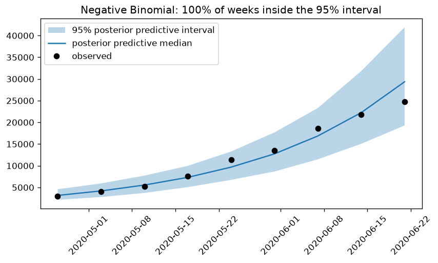
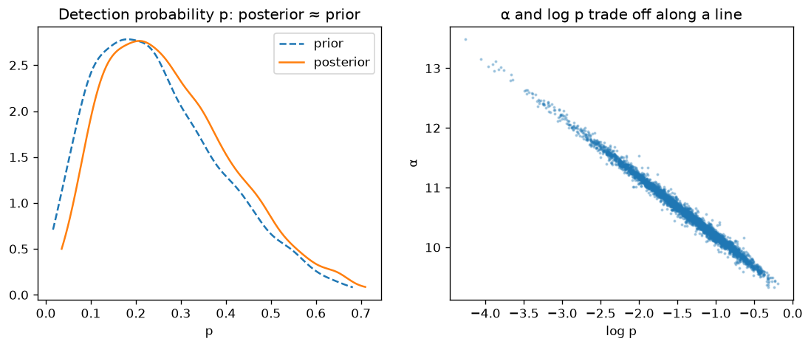

# Bayesian Modelling of Infectious-Disease Case Counts

**Question:** How can Bayesian methods estimate trends in reported disease cases,
and how certain are those estimates? What can reported counts *not* tell us?

## What the project does
1. Tests the model on simulated data with known parameters (parameter recovery).
2. Fits a log-linear **Poisson** model to weekly COVID-19 cases in Bangladesh
   (first growth phase, late April to late June 2020) using MCMC in PyMC.
3. Checks convergence with trace plots, R-hat, effective sample size and divergences.
4. Uses posterior predictive checks to show the Poisson model is overconfident,
   then fits a **Negative Binomial** model and compares the two with LOO.
5. Adds a **detection probability** to show that true infections cannot be
   identified from reported counts alone, while the growth rate still can,
   plus a sensitivity analysis.

## Data
Our World in Data COVID-19 dataset
(`https://catalog.ourworldindata.org/garden/covid/latest/compact/compact.csv`),
daily new cases aggregated to weekly totals. Downloaded on: **17 November 2026**.
The first run downloads about 185 MB and saves the chosen country to `data/cases_<Country>.csv`.

## How to run
```bash
pip install -r requirements.txt
jupyter notebook bayesian_case_counts.ipynb
```
Or run `python bayesian_case_counts.py`. Figures are saved in `figures/<Country>/`.

## Key results
Bangladesh, weekly reported cases, weeks ending 26 April – 21 June 2020 (9 weeks):
- Weekly growth factor (Negative Binomial): **1.32** (95% credible interval 1.26–1.38)
- Doubling time: about **2.5 weeks** (95% credible interval 2.1–2.9)
- Model comparison: the Poisson model covered only **11%** of observed weeks in its 95%
  predictive interval; the Negative Binomial covered **100%** and was strongly preferred by LOO.
- Detection probability: the posterior of *p* is almost identical to its prior → not identifiable.
  Depending on the assumed *p* (1.0 to 0.1), true cases in the window range from about
  **112,000 to 1.1 million**, against 109,850 reported.
- Convergence: R-hat = 1.00 for all parameters, no divergent transitions.





## Limitations
- A single log-linear trend fits only one growth phase.
- Reported counts depend on testing volume and reporting delays.
- Few data points, so LOO is unstable (Pareto k̂ warnings).
- True infections need extra information (serology, testing data, or multiple
  data sources as in capture-recapture).

## Tools
Python, pandas, NumPy, SciPy, PyMC, ArviZ, Matplotlib.

## Acknowledgement
Code and documentation were developed with the assistance of AI tools. I ran,
checked, and interpreted the analysis.
